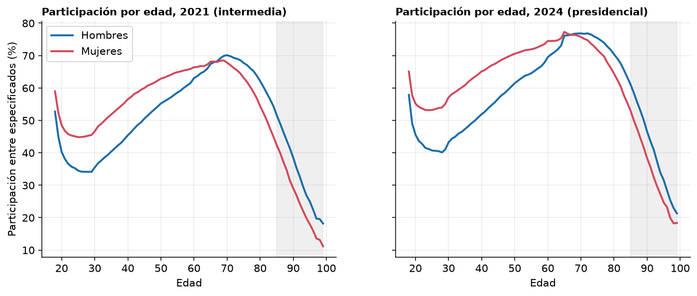
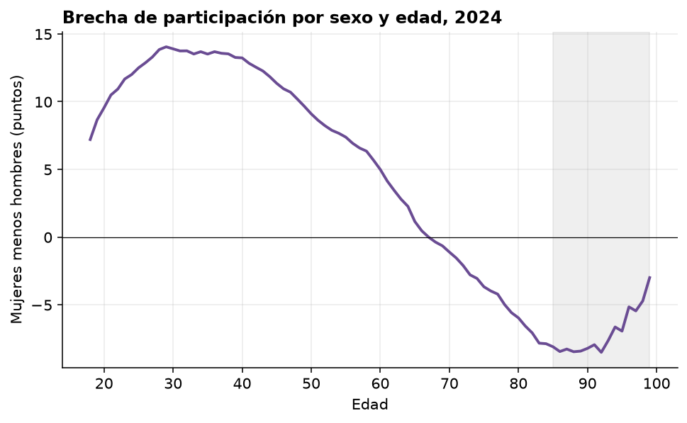
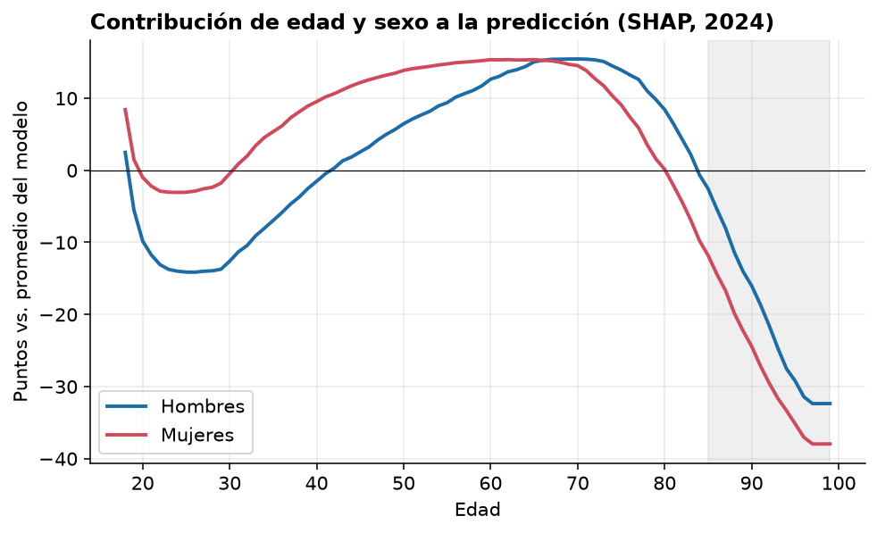
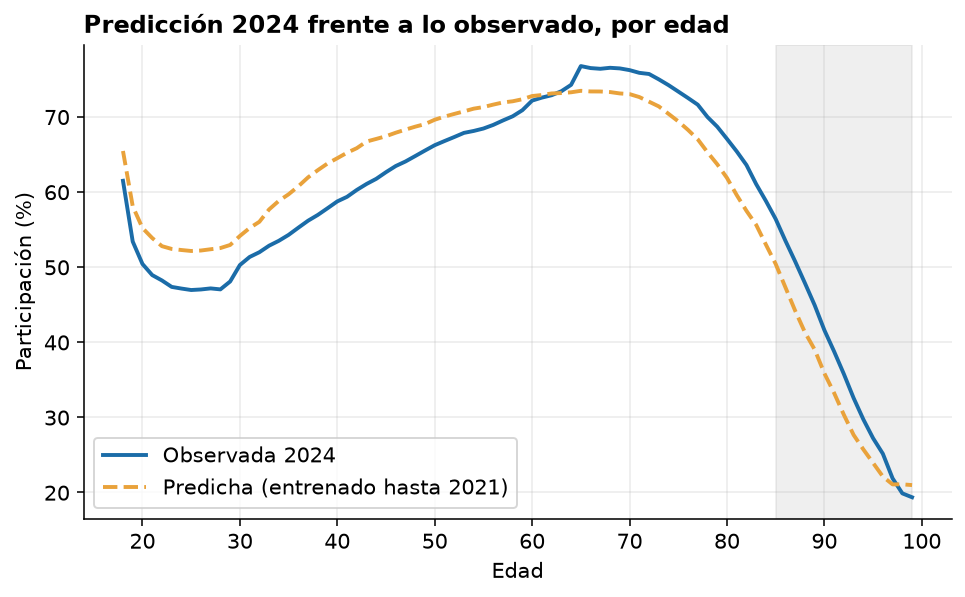
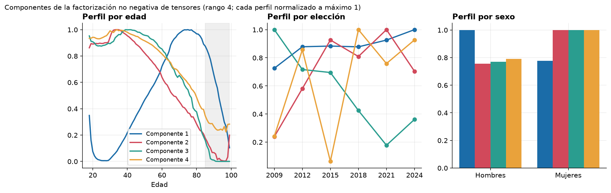
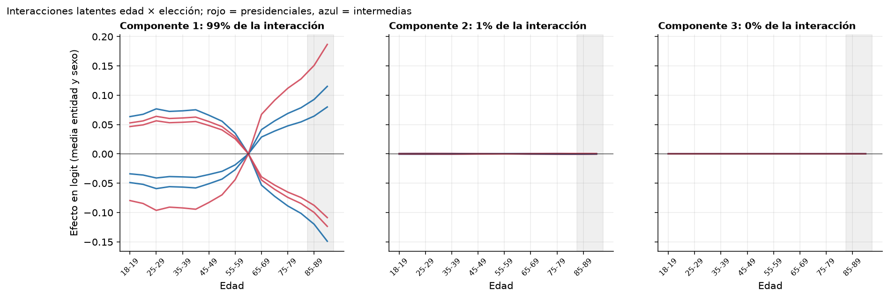
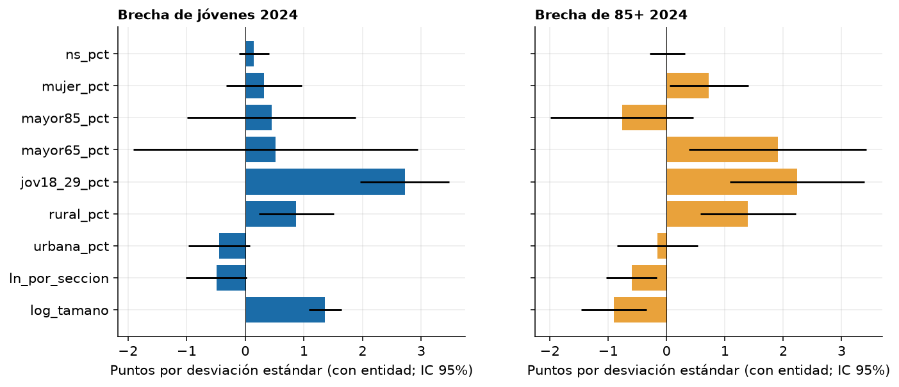
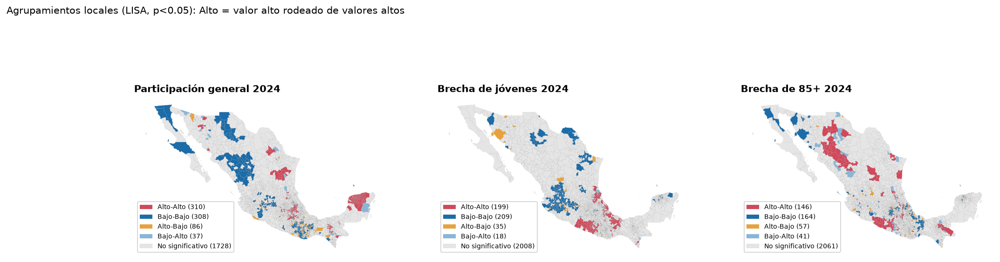
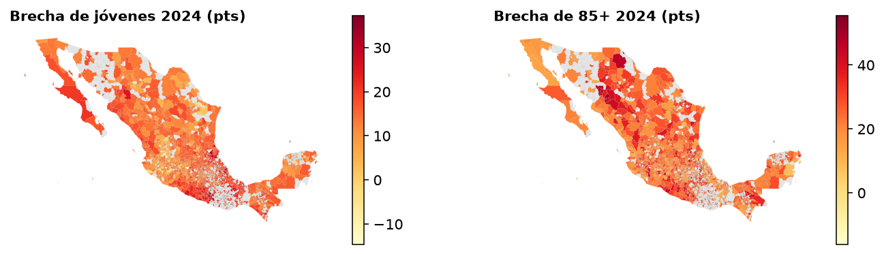

# Centro de Inteligencia y Visualización de Información para el Análisis Electoral

Proyecto para el **Hackathon INE 2026 · Reto 1: Perfiles ciudadanos de participación**. El nombre del proyecto es provisional.

Buscamos identificar quiénes participan, qué características comparten, dónde se presentan diferencias y qué estrategias podrían contribuir a aumentar la participación ciudadana en México.

## Contexto del reto

El Reto 1 propone estudiar los patrones electorales de distintos grupos poblacionales para construir perfiles que ayuden a comprender su participación y plantear estrategias para incentivarla. Nuestro proyecto aborda este reto mediante análisis histórico, territorial y demográfico.

Fuente oficial: [Hackathon INE 2026](https://www.ine.mx/hackathon-2026/).

## Objetivo general

Desarrollar una plataforma inteligente de análisis de participación electoral, mediante técnicas de ciencia de datos, estadística y aprendizaje automático, que permita identificar, caracterizar y comparar perfiles de participación y abstención ciudadana en México, utilizando información histórica de los procesos electorales de 2009 a 2024, con el propósito de generar hallazgos y recomendaciones basadas en evidencia que contribuyan al diseño de estrategias focalizadas para fortalecer la participación democrática.

## Objetivos específicos

1. Identificar perfiles de participación electoral mediante variables sociodemográficas y territoriales, como sexo, grupo de edad, entidad federativa, municipio y tipo de sección electoral.
2. Analizar patrones históricos de participación y abstención electoral durante el periodo 2009–2024.
3. Comparar diferencias regionales entre norte, centro y sur, identificando características comunes y diferencias entre los grupos poblacionales.
4. Implementar técnicas de segmentación, como clustering, para identificar grupos con comportamientos electorales similares.
5. Generar hallazgos e interpretaciones sobre qué grupos presentan mayores o menores tasas de participación y cómo varían territorialmente.
6. Proponer estrategias focalizadas de educación cívica, comunicación y promoción de la participación ciudadana, sustentadas en los perfiles identificados.

## Enfoque técnico previsto

1. **Datos históricos del INE:** seis procesos electorales de 2009 a 2024 y un dataset maestro local de 546,968 registros agregados.
2. **Procesamiento y análisis:** ETL, normalización, limpieza, validación de conteos, construcción de indicadores y segmentación territorial y demográfica.
3. **Construcción de perfiles ciudadanos:** estadística multivariada y aprendizaje no supervisado para explorar grupos con comportamientos similares.
4. **Exploración interactiva:** visualizaciones, comparación de perfiles y presentación de hallazgos.
5. **Recomendaciones estratégicas:** propuestas diferenciadas de educación cívica, comunicación y promoción de la participación, sustentadas en los resultados del análisis.

La etapa de exploración ya cuenta con una segmentación sociodemográfica y resultados publicados. La plataforma interactiva y la validación adicional siguen dentro del alcance previsto.

## Perfiles por sexo y edad (propuesta actual)

Propuesta de cuatro perfiles nacionales de participación (alta, intermedia, baja y muy mayores) definidos por sexo y edad simple, con un ajuste por región y tipo de sección. Explicación completa, figuras, tratamiento de los no especificados y de las personas no binarias, robustez y límites en [reports/perfiles_sexo_edad/](reports/perfiles_sexo_edad/README.md).

## Resultados de la segmentación sociodemográfica

El análisis agrupa 144 segmentos definidos por región, sexo, grupo de edad y tipo de sección, comparando su participación en seis elecciones. Se presentan dos perfiles por región, con nombres descriptivos, composición exacta e indicadores históricos.

- [Seis fichas completas: dos perfiles por región](reports/sociodemografico/fichas_dos_perfiles_por_region.md).
- [Informe con gráficas y metodología](reports/sociodemografico/informe_sociodemografico.html). Para visualizarlo, descargar el repositorio y abrir este HTML en un navegador, conservando los PNG en la misma carpeta.
- [Todos los plots y tablas de resultados](reports/sociodemografico/).
- [Instrucciones para reproducir el análisis](scripts/README.md).

Los archivos CSV de esta carpeta son resultados agregados del análisis; el dataset maestro y el diccionario de trabajo permanecen locales. Los perfiles son exploratorios y no identifican personas ni causas de participación. La categoría no binario se describe aparte por disponer únicamente de registros de 2024.

## Variación territorial (exploratorio)

Análisis a nivel municipio con datos del INE (≈1,400–1,600 municipios por elección, con al menos 100 registros especificados por grupo). La brecha es la participación de 35-64 años menos la del grupo comparado, en puntos porcentuales. Script: `05_variacion_territorial.py`; resultados en `outputs/`.

- **La brecha cambia con el lugar.** En 2024, la brecha de 18-34 años va de 7.9 a 21.6 puntos entre municipios (p10–p90) y la de 85+ de 14.0 a 33.3. La entidad explica 41% de la variación de la primera y 28% de la segunda; el resto es variación dentro de la entidad.
- **Las dos brechas casi no se relacionan** (correlación entre municipios de −0.01 a 0.19), lo que apoya diseñar estrategias separadas para jóvenes y para 85+.
- **Efecto de ciclo.** Todos los grupos suben entre 10.6 y 13.2 puntos en elecciones presidenciales frente a intermedias; los jóvenes suben más.

Son asociaciones entre municipios, no causas ni comportamiento individual. No se verificó si la lista nominal de 85+ incluye registros de personas fallecidas o que ya no residen en la sección, por lo que su abstención puede estar sobrestimada.

## Modelo predictivo con boosting e interpretación SHAP (exploratorio)

LightGBM con SHAP sobre datos del INE. Scripts: `09_boosting_shap.py` (celdas municipio × tipo de sección × sexo × grupo de edad) y `10_boosting_edad_simple.py` (entidad × tipo de sección × sexo × edad simple 18–99, que permite ver a 85+). Se entrena con 2009–2021 y se predice 2024. Las edades de 100 años o más (≈0.02% de la lista nominal) se excluyen por posible error de registro.

- **No supera a una regla simple.** Con edad simple, R² ponderado de 0.80 y error medio de 4.7 puntos, igual que una tabla de medias o que repetir la celda de 2018. Con grupos de edad y municipio llega a 0.74, frente a 0.62 sin municipio: saber el lugar aporta unos 12 puntos de R².
- **Edad y tipo de elección dominan.** Importancia SHAP media: edad 11.6 puntos, elección presidencial 5.5, entidad 3.5, sexo 2.1 y tipo de sección 1.7 (modelo con edad simple).
- **El sexo cambia el patrón por edad.** Hasta cerca de los 65 años las mujeres participan más que los hombres (hasta 13.5 puntos en 2024 a los 35); desde los 75 años la relación se invierte (≈8 puntos menos en mujeres a los 85).
- **La participación a los 18 años sube** (≈58% en hombres y 65% en mujeres en 2024) frente a la de los 20 a 29 años (≈41% y 53%).
- **El modelo subestima a 85+ en 2024** (predice 44.6% y 36.1% en hombres y mujeres, contra 50.3% y 41.6% observados) y sobreestima a 18–64: el patrón por edad de 2024 se desvió de la tendencia previa.






SHAP explica al modelo, no causas, y con variables correlacionadas el reparto entre ellas es una convención. Las edades se agrupan a nivel entidad en el modelo con edad simple. Tablas en `outputs/tablas/boosting_*`.

## Factorización de tensores (exploratorio)

Dos enfoques sobre la participación por edad, sexo, lugar y elección, con datos del INE. El segundo se inspira en [Zens, *Bayesian Adaptive Tensor Smoothing for Multiway Demographic Counts* (arXiv 2502.09255)](https://arxiv.org/abs/2502.09255), pero **no es ese modelo**: es una versión simplificada propia (sin procesos gaussianos ni sus priors global-local).

**1. Factorización no negativa de tensores** (`11_tensor_ntf.py`, `11b_tensor_ntf_final.py`). Tensor de 2,477 municipios × sexo × edad simple (18–99) × 6 elecciones, con ponderación por tamaño de celda. Con 4 componentes el error en celdas retenidas es 0.065, frente a 0.119 de la referencia sin municipio; los perfiles de edad coinciden entre semillas (coseno ≥ 0.986). El rango 4 es una elección de los autores: el error sigue bajando hasta 8.

- El componente 1 se concentra en 65–85 años, es más alto en hombres y casi no cambia entre elecciones; domina en 1,702 municipios.
- El componente 4 corresponde a adultos de 30–60 con pico en elecciones presidenciales; domina en 161.
- Los componentes 2 y 3 también describen a adultos y decaen con la edad; su perfil por elección no se pudo interpretar y puede reflejar cambios de periodo o de padrón.
- La mezcla de componentes es parecida entre entidades.



**2. Tensor bayesiano simplificado** (`12_tensor_bayes.py`). Entidad × sexo × 16 bandas de edad × elección, con efectos principales suaves en edad y elección más interacciones de bajo rango con encogimiento, y verosimilitud normal sobre el logit de la tasa (la beta-binomial sobre conteos grandes no permitió que el muestreador explorara). MCMC con NumPyro, 2 cadenas de 1,500 iteraciones; R-hat máximo de 1.021 sobre las cantidades identificadas y 2–3 divergencias.

- Las interacciones mejoran poco: error medio en celdas retenidas de 4.77 puntos frente a 4.92 sin ellas. El rango efectivo es 1 (un componente aporta 99% de la interacción).
- Ese componente es una inclinación del perfil de edad que cambia de elección en elección, con amplitud máxima de ≈0.2 en logit. Por entidad su amplitud va de 0.02 a 0.12.
- Una dispersión residual de ≈0.27 (logit) queda sin explicar: una estructura de bajo rango compartida no captura todo.



Los componentes son patrones estadísticos, no tipos de personas. Tablas en `outputs/tablas/tensor_*`.

## Cotejo del dataset maestro contra los originales

`13_cotejo_maestro.py` reagrupa las 54,872,712 filas originales (sin filas eliminadas) al grano del maestro (año × entidad × municipio × sexo × tipo de sección × grupo de edad) y compara conteo por conteo. **Coinciden las 546,968 celdas** en lista nominal, votos, no votos, no especificados y número de registros de origen, sin celdas solo en uno de los dos conjuntos. Los totales por elección también coinciden. Además, `lista_nominal = si_votaron + no_votaron + no_especificados` en todas las filas, no hay llaves duplicadas y `participacion_pct` coincide con su recálculo (diferencia máxima de 5·10⁻⁷). Resultados en `outputs/tablas/cotejo_maestro_*`.

- Las 127,236 filas originales de edad de 100 años o más están incluidas en el grupo 85+ del maestro, que por eso mezcla edades muy altas, probablemente erróneas. Los análisis con edad simple de este repositorio las excluyen (≈0.02% de la lista nominal).
- 4,685 filas tienen participación nula porque el denominador (votos + no votos) es cero.
- El cotejo parte de la tabla de trabajo local `data/processed/`, que el ETL generó de los ZIP sin eliminar filas; los totales por elección coinciden con los que el ETL calculó directamente de los ZIP.

## Variables de contexto municipal derivadas del padrón (exploratorio)

El maestro no trae variables sociodemográficas adicionales (solo `region`, nombres y un indicador de calidad), así que `14_contexto_municipal.py` deriva de los originales variables de contexto del propio INE: tamaño del municipio, número y tamaño de secciones, % de lista nominal en secciones urbanas y rurales, % de 18–29, 65+ y 85+, % de mujeres y % no especificado. Se asocian con las brechas municipales de 2021 y 2024 (regresión estandarizada, con y sin efectos fijos de entidad, errores agrupados por entidad).

- Explican más que antes: R² de 0.58 (brecha de jóvenes) y 0.38 (brecha de 85+) en 2024 con entidad.
- **Tamaño del municipio:** los municipios más grandes tienen brecha de jóvenes mayor (≈ +1.4 a +2.1 pts por desviación estándar, ambos años) y brecha de 85+ menor.
- **Proporción de jóvenes (18–29) en la lista nominal:** se asocia con brechas mayores en ambos grupos (≈ +2.1 a +2.7 pts en jóvenes y +1.9 a +2.2 en 85+).
- **Ruralidad:** se asocia con brechas mayores en los dos grupos en 2024; la proporción urbana, no.

Estas variables salen del mismo padrón. Por ejemplo, si un municipio tiene muchas personas jóvenes en la lista nominal que ya no viven ahí, su "brecha" puede ser un artefacto del padrón y no de comportamiento. Son asociaciones entre municipios, no causas.



## Análisis espacial (exploratorio)

`16_espacial.py` usa la vecindad geográfica entre municipios (contigüidad tipo reina) con el Marco Geoestadístico 2020 de INEGI. **Esas geometrías son un dato externo al INE**: se descargaron de una copia en un repositorio público de terceros (PhantomInsights/mexico-geojson), se guardan en `data/external/` (ignorado por Git) y solo sirven para saber quién es vecino de quién; no se usa ninguna variable adicional. La unión por clave de municipio es casi completa (2,466 de 2,477 municipios en 2024); los 11 sin geometría son probablemente municipios creados después de 2020.

- **Hay autocorrelación espacial fuerte.** I de Moran en 2024: 0.41 para participación general, 0.46 para la brecha de jóvenes y 0.31 para la de 85+ (p < 0.01 con 999 permutaciones).
- **Gran parte es efecto de la entidad.** Al quitar la media de cada entidad, el I baja a 0.05–0.11: sigue siendo significativo, pero la estructura espacial dentro de la entidad es débil.
- **Los vecinos aportan poco más que la entidad.** Para predecir la brecha de jóvenes de 2024, la media de la entidad (sin el propio municipio) explica 39% y la de los vecinos 37%; juntas, 43%. Para 85+, 26%, 21% y 29%.
- **Agrupamientos locales (LISA) 2024:** hay zonas de brecha de jóvenes alta en el sur y centro-sur del país y zonas de brecha baja en el centro-oeste y el norte; la brecha de 85+ es alta en una zona del norte-centro y otra del sur. La lectura por estado es aproximada, a partir del mapa.

Las brechas se calculan solo en municipios con al menos 100 registros por grupo (≈1,600), así que en las brechas hay municipios sin dato que dejan 27–28 sin vecinos con dato; los resultados de la participación general (2,454 municipios) no tienen ese problema. Son asociaciones, no causas.




## Preguntas que buscamos responder

- ¿Qué perfiles demográficos presentan menor participación electoral?
- ¿Existen patrones similares entre municipios de distintas entidades?
- ¿La participación de mujeres y hombres muestra diferencias según la edad y la región?
- ¿Qué características distinguen a los territorios con mayor participación?
- ¿Qué estrategias podrían ser más pertinentes para cada perfil identificado?

Los perfiles serán **estadísticos y agregados**. Las unidades de análisis son grupos poblacionales y territorios; los resultados no describen el comportamiento de votantes individuales. Las diferencias y asociaciones observadas no permiten atribuir causas sin evidencia adicional.

## Datos originales

Se incluyen seis paquetes de Conteos Censales de Participación Ciudadana del INE, correspondientes a **2009, 2012, 2015, 2018, 2021 y 2024**. Cada paquete contiene 32 CSV, uno por entidad federativa, y un diccionario de campos.

Los ZIP se conservan sin modificaciones en `data/raw/`.

| Campo | Significado |
| --- | --- |
| LN | Lista nominal |
| SV | Registros con marca de voto |
| NV | Registros sin marca de voto |
| NS | Registros con participación no especificada |

La validación de consistencia considera `LN = SV + NV + NS`. Los registros no especificados se conservan como una categoría independiente y no se contabilizan como abstención.

Según los diccionarios incluidos en los paquetes, la fuente son los cuadernillos de las listas nominales; no contempla la participación en casillas especiales ni el voto desde el extranjero. Estos conteos no equivalen a resultados por partido o candidatura.

## Criterios de análisis

La regionalización en norte, centro y sur es una **propuesta propia del proyecto basada en información del INEGI**; no constituye una división oficial del INEGI. La referencia específica utilizada queda pendiente de documentar.

En el maestro local, la participación se calcula como `SV / (SV + NV) × 100`: participación entre registros con situación especificada. Si el denominador es cero, el porcentaje queda sin valor. Para consolidar grupos se suman primero los conteos y después se recalcula el porcentaje. El porcentaje de registros no especificados se analiza por separado para contextualizar los resultados.

## Organización

```text
data/
  raw/          # ZIP originales incluidos en el repositorio
  processed/    # Maestro y datos procesados: solo locales, ignorados por Git
  catalogs/     # Diccionarios de trabajo: solo locales, ignorados por Git
reports/
  sociodemografico/  # Resultados autorizados para publicación
  local/            # Resultados de ejecución local, ignorados por Git
scripts/            # Análisis reproducible
```

El dataset maestro y el diccionario de regiones permanecen exclusivamente en el entorno local y no se publican en este repositorio.

## Equipo desarrollador

- Valeria Jahzeel Castañon Hernandez
- Johanna Keira Badillo Zavala
- Ernesto Mendieta Cuecuecha
- Rodrigo Paredes Urrusquieta
