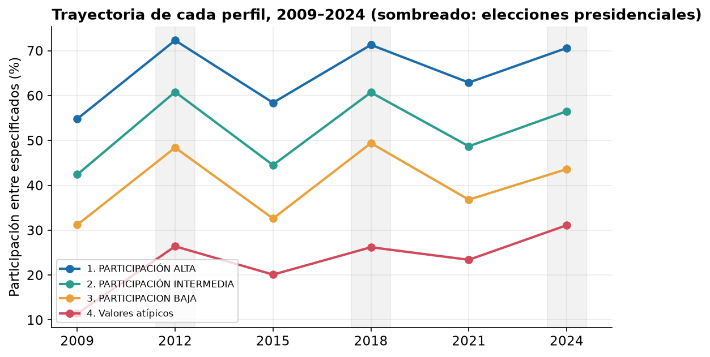
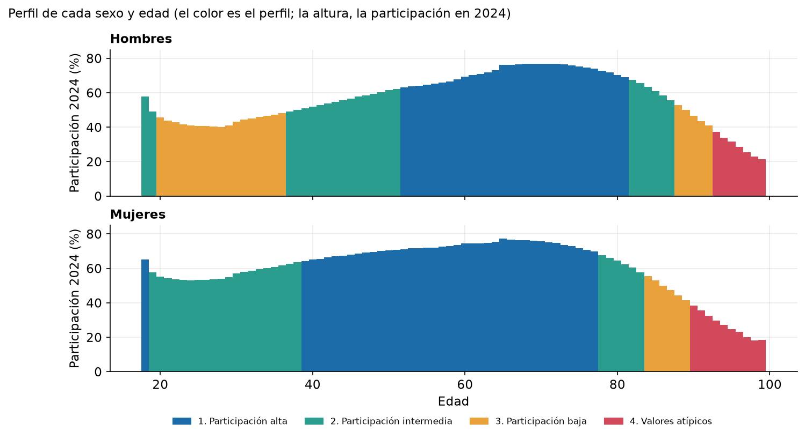
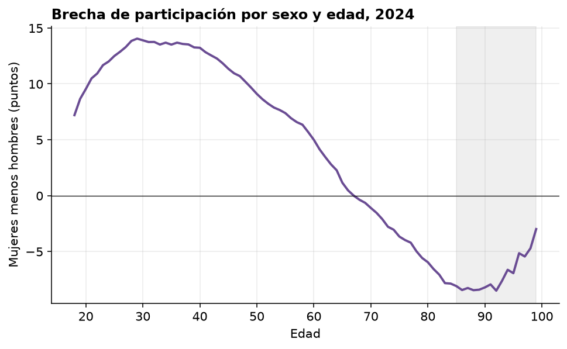
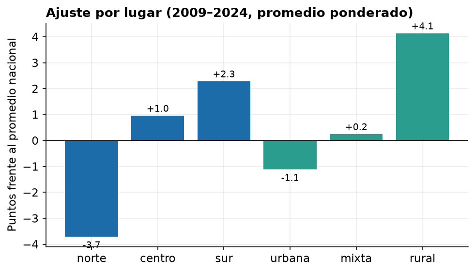
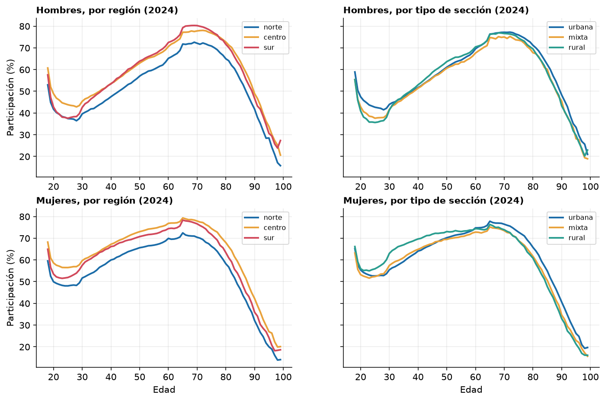

# Perfiles ciudadanos de participación electoral en México, 2009–2024

**Documento técnico · Hackathon INE 2026 · Reto 1: Perfiles ciudadanos de participación**

Centro de Inteligencia y Visualización de Información para el Análisis Electoral (nombre provisional)
Equipo: Valeria Jahzeel Castañon Hernandez, Johanna Keira Badillo Zavala, Ernesto Mendieta Cuecuecha y Rodrigo Paredes Urrusquieta.

> **Cómo leer los resultados.** Los perfiles describen la participación observada de **grupos de personas** (sexo y edad) a partir de datos agregados del INE. No describen a individuos ni explican por qué participan o dejan de participar. Las estrategias de la sección 6 son **hipótesis para probar en pilotos**, no recomendaciones basadas en causas.

---

## 0. Resumen ejecutivo

**Pregunta.** ¿Quiénes participan menos en las elecciones federales, dónde se ve la diferencia y qué se puede hacer de forma distinta para cada grupo?

**Respuesta en cuatro puntos.**

1. **La participación se ordena sobre todo por la edad, y el sexo desplaza la curva.** En 2024 cae después de los 18 años hasta un mínimo entre los 24 y 28, sube hasta un máximo entre los 65 y 72 y baja en las edades muy avanzadas ([curvas por edad](../outputs/tablas/boosting_edad_curvas.csv)). Las mujeres llegan al nivel alto unos 13 años antes que los hombres (a los 39 frente a los 52).
2. **Cuatro perfiles nacionales resumen ese patrón** y están claramente diferenciados en nivel: en 2024 participan 70.6 %, 56.5 %, 43.6 % y 31.1 %, con saltos de 11 a 23 puntos entre perfiles consecutivos en las seis elecciones. Tres perfiles cubren el 99.6 % de la lista nominal; el cuarto (0.4 %) es pequeño y debe leerse con reserva.
3. **Los perfiles son cortes de un gradiente, no grupos naturales.** Lo comprobamos con tres pruebas independientes de tendencia al agrupamiento (Hopkins y VAT, contra referencias sin grupos). Ninguna encontró grupos de votantes: la estructura es un gradiente por edad y la única señal adicional, en la forma de la trayectoria, es territorial. Por eso el número de perfiles se justifica por utilidad y estabilidad, no por una separación que los datos no muestran.
4. **Las estrategias se diferencian por perfil, por momento del ciclo y por territorio.** El mayor espacio de mejora está en dos grupos: las personas del perfil intermedio (39 % de la lista nominal), cuya participación cae unos 14 puntos en las elecciones intermedias, y los hombres de 20 a 36 años (18.7 % de la lista nominal, 43 % de participación en 2024).

| # | Perfil | Quiénes son (resumen) | % lista nominal 2024 | Participación 2024 |
|---|---|---|---|---|
| 1 | Participación alta | Mujeres de 39 a 77 años y hombres de 52 a 81 | 41.0 % | 70.6 % |
| 2 | Participación intermedia | Mujeres de 19 a 38, hombres de 37 a 51 (y tramos pequeños de 18–19 y 78–87) | 39.0 % | 56.5 % |
| 3 | Participación baja | Hombres de 20 a 36 años (96 % del perfil) y personas de 84 a 92 | 19.6 % | 43.6 % |
| 4 | Valores atípicos | Hombres de 93 a 99 y mujeres de 90 a 99 | 0.4 % | 31.1 % |

---

## 1. Problema y objetivo

El Reto 1 pide estudiar los patrones electorales de distintos grupos poblacionales para construir perfiles que ayuden a comprender su participación y a plantear estrategias para incentivarla. Este proyecto lo aborda con análisis histórico, territorial y demográfico de seis elecciones federales (2009, 2012, 2015, 2018, 2021 y 2024).

**Objetivo general.** Identificar, caracterizar y comparar perfiles de participación y abstención ciudadana en México, para generar hallazgos y recomendaciones basadas en evidencia que contribuyan a diseñar estrategias focalizadas.

**Lo que este documento cubre** (objetivos específicos 1, 4, 5 y 6 del [README](../README.md)):

- La descripción de los perfiles (sección 4).
- La metodología de segmentación y su justificación (sección 3).
- Las estrategias diferenciadas (sección 6).

**Restricción de los datos.** Solo se dispone de conteos agregados por sección electoral, sexo y edad. No hay escolaridad, ingreso, ocupación ni motivos. Esto limita qué se puede afirmar (sección 8).

---

## 2. Datos y unidad de análisis

**Fuente.** Conteos Censales de Participación Ciudadana del INE, seis paquetes (2009–2024), con la lista nominal (LN), los registros con marca de voto (SV), sin marca de voto (NV) y con participación no especificada (NS). Provienen de los cuadernillos de las listas nominales; no incluyen casillas especiales ni voto desde el extranjero.

**Indicador.** Participación = SV / (SV + NV). Los registros no especificados no se cuentan como voto ni como abstención. Al contarlos como "no votó", los 164 segmentos conservan su perfil (ARI = 1.0).

**Calidad.** El dataset maestro (546,968 celdas) coincide celda por celda con las 54,872,712 filas originales, en lista nominal, votos, no votos y no especificados.

**Exclusiones.**

- Las edades de 100 años o más (≈0.02 % de la lista nominal), por posible error de registro.
- Las personas no binarias: el INE solo registra esta categoría en 2024, con 105 registros, y sin historial no se puede construir una trayectoria. Es una limitación de los datos, no una decisión sobre su relevancia.

**Unidades de análisis.** Se usaron tres, según la etapa:

| Etapa | Unidad | Filas |
|---|---|---|
| Fichas por región (3.1) | región × sexo × grupo de edad (8) × tipo de sección | 144 segmentos |
| Pruebas de tendencia al agrupamiento (3.2) | entidad × sexo × grupo de edad × sección | 1,458 unidades |
| Perfiles adoptados (3.4) | sexo × edad simple (18 a 99 años) | 164 segmentos |

Cada unidad se describe con **seis variables**: su participación en cada elección.

---

## 3. Metodología de segmentación

### 3.1 Primera segmentación: dos perfiles por región (fichas)

**Qué se hizo.** Se agruparon 144 segmentos elegibles (de 160) definidos por región (norte, centro, sur), sexo, grupo de edad y tipo de sección (urbana, mixta, rural). Se exigieron seis elecciones presentes, al menos 100 registros especificados y no más de 20 % de no especificados en cada una. Las seis participaciones se estandarizaron por región. Se compararon k-means, Ward y mezclas gaussianas con k de 2 a 5, y se eligió k = 2 por silhouette, tamaño mínimo y estabilidad frente a submuestras.

**Por qué así.** El objetivo 1 pide perfiles a partir de variables sociodemográficas y territoriales, y esas eran las disponibles. Incluir la región en el segmento mantenía el territorio dentro del perfil.

**Resultado.** Dos perfiles por región, uno de menor y otro de mayor participación ([fichas](sociodemografico/fichas_dos_perfiles_por_region.md)):

| Región | Perfil A (menor) 2024 | Perfil B (mayor) 2024 |
|---|---|---|
| Norte | 44.9 % | 63.1 % |
| Centro | 46.5 % | 65.9 % |
| Sur | 47.1 % | 67.7 % |

**La pregunta que dejó abierta.** Las propias fichas advierten que k = 2 "no demuestra que existan únicamente dos tipos naturales de ciudadanía". Esa pregunta —si hay grupos que los datos separan por sí solos— es la que contesta la sección siguiente.

### 3.2 ¿Hay grupos naturales? Tres pruebas independientes

**Prueba usada.** Se aplicó la estadística de Hopkins (cerca de 0.5 indica puntos sin estructura; cerca de 1, puntos agrupados) y el VAT, una imagen de la matriz de distancias reordenada en la que los grupos aparecen como cuadrados oscuros en la diagonal y un gradiente aparece como un degradado.

**Cuidado necesario.** Seis tasas de participación están muy correlacionadas, así que los puntos forman una nube alargada, y eso eleva Hopkins aunque no haya grupos. Por eso cada resultado se compara con una **referencia sin grupos con la misma covarianza** (y, para los 164 y 144 segmentos, con una curva continua por construcción). Lo que cuenta es la diferencia `delta = H_real − H_referencia`.

Las tres pruebas se hicieron sobre unidades distintas, para que la conclusión no dependa de una sola forma de armar la tabla:

| # | Qué se probó | Unidad | Resultado | Veredicto formal |
|---|---|---|---|---|
| 1 | **Forma** de la trayectoria (ciclo presidencial/intermedio y tendencias, sin el nivel) | 1,458 unidades | `forma`: Hopkins real 0.748–0.810 · gaussiano 0.649–0.723 · `delta` +0.086 a +0.099. `ciclo`: Hopkins real 0.766–0.823 · gaussiano 0.766–0.819 · `delta` −0.016 a +0.013 | Sin evidencia en el ciclo; moderada solo en la forma con efecto entidad |
| 2 | Los **164 segmentos** que dan los perfiles adoptados | 164 segmentos | Hopkins real 0.946 · gaussiano 0.935–0.936 · `delta` +0.010 a +0.011 | **Ambiguo**: un solo salto real, a los 18 años |
| 3 | Los **144 segmentos** de las fichas | 144 segmentos | Hopkins real 0.831–0.867 · gaussiano 0.851–0.881 · `delta` −0.022 a −0.001 | **Ambiguo**; sin estructura más allá del gradiente en la sensibilidad |

*En la prueba 1, `forma` y `ciclo` son las dos representaciones de la trayectoria; al quitar el efecto entidad, `forma` baja a `delta` de +0.032 a +0.068. El veredicto de las pruebas 2 y 3 no sale solo de la comparación con la nube gaussiana: usa además una curva continua (prueba 2) y un gradiente por edad (prueba 3) como referencias, descritas abajo.*

**Cómo se lee la tabla.**

- *Prueba 1.* Se quita el nivel de participación y se usa solo cómo cambia entre elecciones. Las variables de forma casi no se correlacionan con el nivel (|r| ≤ 0.17), así que es otro eje. La única señal (`forma` con efecto entidad) se debilita al quitar la entidad y coincide con el estado (NMI 0.25–0.60), casi nada con la edad (0.00–0.09). El bloque oscuro del VAT de `ciclo` agrupa ≈12 % de las unidades, de solo 10 estados, con una brecha presidencial–intermedia de ≈3 puntos frente a ≈12 en el resto: es un conjunto de estados con ciclo débil, no un perfil de votante.
- *Prueba 2.* Es la tabla que se agrupó para los perfiles adoptados. Frente a una curva continua con la misma forma, `delta` es de +0.009 a +0.017. La participación cambia de forma continua con la edad. La excepción es una discontinuidad real a los 18 años (hombres 2024: 57.9 % a los 18 frente a 49.0 % a los 19); sin ella, los cortes de los perfiles caen donde la curva no da saltos. La causa no se puede determinar con estos datos.
- *Prueba 3.* Frente a un gradiente por edad con ruido independiente, `delta` es de +0.05 a +0.07; con ruido que respeta la correlación entre elecciones, de +0.005 a +0.019. Con solo 8 grupos de edad no se puede probar continuidad, pero sí que la edad explica el 80–81 % de la varianza de las seis tasas, y sexo × edad el 94–96 %. Los dos perfiles de las fichas son cortes de edad: los 85+ van siempre en el perfil A y los de 45 a 84 años siempre en el B.
- *Dos veredictos "ambiguo".* La regla de decisión se fijó antes de ejecutar. En las pruebas 2 y 3 el resultado formal quedó en "ambiguo", y las sensibilidades que lo resuelven (excluir la frontera de los 18 años; usar ruido correlacionado) se agregaron **después** de ver el primer resultado. Por eso no sustituyen al veredicto formal, y así se reportan. Detalle en [notebooks/README.md](../notebooks/README.md).

**Por qué las tres pruebas coinciden.** En las pruebas 2 y 3 las seis tasas son casi un solo eje (qué tan alto participa un grupo); ese eje lo ordena la edad, con una curva en U invertida y máximo a los 65–74 años, y el sexo, la sección y la región lo desplazan sin formar grupos propios. La prueba 1 comprueba que, al quitar ese eje, tampoco aparecen grupos de votantes: lo que queda de forma es sobre todo territorial.

**Por qué silhouette y ARI no bastan.** En `perfiles_sexo_edad` la silhouette va de 0.51 a 0.61 y la estabilidad de 0.89 a 0.97, cifras altas. Una simulación de 164 puntos sobre una curva continua, sin grupos por construcción, da 0.51 a 0.59 de silhouette y 0.86 a 0.97 de ARI. Ambas métricas miden qué tan bien separado y qué tan repetible es un corte, no si el corte corresponde a grupos que existen.

### 3.3 Qué se concluye: segmentar sobre el eje que ordena los datos

La ausencia de grupos naturales **no impide segmentar**: k-means, Ward y otros métodos siguen produciendo cortes útiles y estables. Cambia cómo se justifican y cómo se interpretan.

La evidencia señala qué segmentación es más adecuada, no que haya que abandonar la segmentación:

1. **Hay que segmentar sobre la edad**, que es el eje que ordena los datos, y con la resolución suficiente. Las fichas usaban 8 grupos de edad, y el último (85–99 años) junta edades con trayectorias muy distintas: los perfiles de edad simple incluyen tramos de 78 a 99 años con participaciones de 31 % a 64 % en 2024.
2. **El sexo debe formar parte de la definición.** No forma grupos propios, pero desplaza la curva: ignorarlo mezclaría, por ejemplo, a mujeres de 25 años con hombres de 25, cuya participación difiere en hasta 13.5 puntos.
3. **La región y el tipo de sección deben tratarse como un ajuste de nivel**, no como parte del perfil (sección 5).
4. **El número de perfiles es una decisión de resumen**, que se toma por utilidad, parsimonia y estabilidad.

Este es el camino de `perfiles_sexo_edad`, que adoptamos.

### 3.4 Segmentación adoptada

**Unidad.** 164 segmentos nacionales: 2 sexos × 82 edades simples (18 a 99 años), cada uno descrito por su participación en las seis elecciones, estandarizada por elección.

**Elección de k.** Se compararon k de 2 a 6 con k-means y Ward, con silhouette y estabilidad frente a submuestras del 80 % (ARI):

| Grupos | Silhouette (k-means) | ARI medio | ARI mínimo |
|---|---|---|---|
| 2 | 0.605 | 0.897 | 0.636 |
| 3 | 0.593 | 0.966 | 0.852 |
| 4 | 0.566 | 0.959 | 0.817 |
| 5 | 0.518 | 0.889 | 0.759 |
| 6 | 0.505 | 0.916 | 0.781 |

Con k = 2 la silhouette es mayor pero el agrupamiento es el menos estable. Con k = 3 y 4 el resultado es muy estable y se separan estructuras que con 2 quedan mezcladas: las edades más avanzadas y la diferencia por sexo. **Se eligió k = 4 por criterio**, no porque los datos prueben que existan exactamente cuatro tipos. Con 3 grupos, el perfil 4 se fusiona con el 3.

**Ajuste por lugar.** Región (norte, centro, sur) y tipo de sección (urbana, mixta, rural) se tratan como un ajuste de nivel sobre el perfil nacional (sección 5).

**Robustez.**

| Prueba | Resultado |
|---|---|
| Sin la elección de 2009 | ARI = 0.94 |
| Solo elecciones presidenciales | ARI = 0.91 |
| No especificados contados como "no votó" | ARI = 1.0 |
| Reagrupar dentro de cada región y tipo de sección | ARI de 0.93 a 0.99 (centro, norte, urbana, mixta) |
| Orden de los perfiles | Se repite en todos los cortes: 1 > 2 > 3 > 4 |
| Secciones rurales, en especial del sur | ARI de 0.73 (rural) y 0.64 (sur rural): excepción, ver sección 5 |

Un modelo de boosting con interpretación SHAP apunta en el mismo sentido: la edad es la variable que más pesa (11.6 puntos de importancia media, frente a 5.5 de la elección presidencial, 3.5 de la entidad, 2.1 del sexo y 1.7 del tipo de sección), y el modelo no supera una regla simple de medias por edad.

---

## 4. Los perfiles ciudadanos

### 4.1 Qué significa "claramente diferenciados"

Los perfiles están diferenciados **en nivel y trayectoria**, no separados en el espacio de las variables. Se sostiene por tres razones verificables:

1. **Brechas amplias y sostenidas.** Entre perfiles consecutivos la diferencia es de 10.6 a 23.2 puntos en cada una de las seis elecciones.
2. **Orden estable.** El 1 participa siempre más que el 2, el 2 más que el 3 y el 3 más que el 4, en las seis elecciones y en todos los cortes por región y tipo de sección.
3. **Composición distinta e interpretable** por sexo y edad (4.3).

| Perfil | 2009 | 2012 | 2015 | 2018 | 2021 | 2024 | Presidenciales (media) | Intermedias (media) | Diferencia |
|---|---|---|---|---|---|---|---|---|---|
| 1. Participación alta | 54.8 | 72.3 | 58.4 | 71.3 | 62.9 | 70.6 | 71.4 | 58.7 | 12.7 |
| 2. Participación intermedia | 42.4 | 60.8 | 44.5 | 60.7 | 48.7 | 56.5 | 59.3 | 45.2 | 14.1 |
| 3. Participación baja | 31.2 | 48.4 | 32.6 | 49.4 | 36.8 | 43.6 | 47.1 | 33.5 | 13.6 |
| 4. Valores atípicos | 11.4 | 26.4 | 20.1 | 26.2 | 23.4 | 31.1 | 27.9 | 18.3 | 9.6 |

*Participación (%) entre registros con situación especificada. Presidenciales: 2012, 2018 y 2024; intermedias: 2009, 2015 y 2021. Las medias son simples. Fuente: [trayectorias_perfiles.csv](perfiles_sexo_edad/trayectorias_perfiles.csv).*

**Cómo leer la figura anterior.** La participación cambia de forma continua con la edad; los perfiles son cortes de esa curva. Los límites exactos (por ejemplo, 37 frente a 52 años) dependen del método y del número de perfiles elegido, y no son umbrales reales.

### 4.2 Tendencias que comparten los cuatro perfiles

- **Efecto del ciclo.** Todos suben entre 9.6 y 14.1 puntos en las presidenciales frente a las intermedias. Las curvas son casi paralelas: los perfiles se distinguen por nivel, no por forma.
- **Las intermedias suben, las presidenciales de 2024 bajaron.** De 2009 a 2021, la participación en intermedias subió entre 5.6 y 8.1 puntos en los perfiles 1 a 3. En 2024, en cambio, las presidenciales quedaron por debajo de 2018 en los perfiles 2 y 3 (−4.2 y −5.8 puntos) y casi igual en el 1 (−0.7). Las elecciones con más registros no especificados tienen una participación más incierta.

### 4.3 Ficha de cada perfil

Los tamaños y las participaciones por bloque de sexo y edad se calcularon con los conteos originales de 2024 ([tamano_bloques_perfiles_2024.csv](perfiles_sexo_edad/tamano_bloques_perfiles_2024.csv), generado por `scripts/21_tamano_bloques_perfiles.py`).

#### Perfil 1 · Participación alta — el núcleo adulto

| Bloque | % de la lista nominal | Participación 2024 |
|---|---|---|
| Mujeres de 39 a 77 años | 26.9 % | 71.0 % |
| Hombres de 52 a 81 años | 13.4 % | 70.3 % |
| Mujeres de 18 años | 0.8 % | 65.1 % |

- **Qué lo caracteriza.** Mayor nivel (70–72 % en presidenciales, 55–63 % en intermedias) y la mayor parte de la lista nominal. Las mujeres entran a este nivel unos 13 años antes que los hombres.
- **Qué no se puede decir.** Que sea un grupo "comprometido" por naturaleza: es un corte de edad. Las mujeres de 18 años están aquí por la discontinuidad de esa edad, un punto aislado en el borde de la curva, y no porque formen un grupo con las de 39 a 77.

#### Perfil 2 · Participación intermedia — la transición

| Bloque | % de la lista nominal | Participación 2024 |
|---|---|---|
| Mujeres de 19 a 38 años | 22.2 % | 56.8 % |
| Hombres de 37 a 51 años | 13.3 % | 55.5 % |
| Hombres de 18 a 19 años | 1.8 % | 52.7 % |
| Mujeres de 78 a 83 años | 1.1 % | 63.7 % |
| Hombres de 82 a 87 años | 0.6 % | 62.8 % |

- **Qué lo caracteriza.** Es el perfil de las mujeres jóvenes y de los hombres de mediana edad. Su participación sube unos 14 puntos de las intermedias a las presidenciales, y fue de las que más cayó en 2024 frente a 2018 (−4.2).
- **Qué no se puede decir.** Que la distancia con el perfil 1 sea una "falta" de interés. El 91 % del perfil son dos bloques de naturaleza distinta (mujeres jóvenes y hombres de mediana edad). Los tramos de 78 a 87 años (1.7 %) participan en 2024 más que el promedio del perfil (63–64 % frente a 56.5 %): están aquí por la trayectoria de las seis elecciones, no por su nivel de 2024.

#### Perfil 3 · Participación baja — sobre todo hombres jóvenes

| Bloque | % de la lista nominal | Participación 2024 |
|---|---|---|
| Hombres de 20 a 36 años | 18.7 % (18.4 millones) | 43.3 % |
| Mujeres de 84 a 89 años | 0.6 % | 49.6 % |
| Hombres de 88 a 92 años | 0.2 % | 48.0 % |

- **Qué lo caracteriza.** Es el perfil de población amplia con menor participación. Los hombres de 20 a 36 años son el 96 % de su lista nominal. La participación masculina baja de 57.9 % a los 18 a 49.0 % a los 19 y 45.6 % a los 20 (2024). Las mujeres participan más que los hombres entre los 18 y los 65 años, con una diferencia máxima de 13.5 puntos a los 35.

- **Qué no se puede decir.** Que las personas de 84 a 92 años (0.8 % de la lista nominal) comparten razones con los hombres jóvenes: solo se parecen en el nivel de sus seis tasas. Un agrupamiento con k = 5 sigue juntándolos; por eso, cuando se diseñan acciones (sección 6), se tratan por separado **por composición**, no porque el método los separe.

#### Perfil 4 · Valores atípicos — edades muy avanzadas

| Bloque | % de la lista nominal | Participación 2024 |
|---|---|---|
| Mujeres de 90 a 99 años | 0.3 % | 30.9 % |
| Hombres de 93 a 99 años | 0.1 % | 31.8 % |

- **Qué lo caracteriza.** Participación de 11 % a 31 %. Es el perfil más pequeño.
- **Qué no se puede decir.** "Valores atípicos" es el nombre del perfil, no implica que sus registros sean errores ni que se haya aplicado un detector estadístico. Es un **perfil con reserva**: la lista nominal podría incluir personas fallecidas o que ya no residen en su sección, lo que haría parecer menor su participación real. No se verificó con los datos disponibles.

---

## 5. Dónde y cuándo cambia el nivel

### 5.1 Región y tipo de sección: mueven el nivel, no la forma

La curva nacional de sexo × edad × elección explica el 95 % de la variación en las celdas de cada región y de cada tipo de sección. Si a cada grupo se le suma un nivel propio, el ajuste sube a 99.6 % (regiones) y 98.9 % (tipos de sección). El ajuste de nivel, en puntos porcentuales:

| Norte | Centro | Sur | Urbana | Mixta | Rural |
|---|---|---|---|---|---|
| −3.7 | +1.0 | +2.3 | −1.1 | +0.3 | +4.1 |

Que el 95 % se explique con edad y sexo no vuelve irrelevante el lugar: la edad domina tanto que 4 a 7 puntos de diferencia por región o por tipo de sección siguen siendo relevantes en la práctica.

**Excepción: las secciones rurales, sobre todo las del sur.** Ahí cambia también la forma del patrón por edad y sus perfiles propios coinciden menos con los nacionales. Se recomienda tratarlas como un caso aparte.

### 5.2 El lugar importa más a nivel de municipio que de región

En ≈1,600 municipios con datos suficientes en 2024, la diferencia de participación entre adultos de 35–64 y jóvenes de 18–34 va de **7.9 a 21.6 puntos** entre municipios (percentiles 10 a 90); la de 35–64 frente a 85+ va de 14.0 a 33.3. La entidad explica el 41 % y el 28 % de esa variación, respectivamente; el resto ocurre dentro de la entidad.

- **Las dos brechas casi no se relacionan** (correlación entre municipios de −0.01 a 0.19). Es el argumento más directo para diseñar acciones separadas para jóvenes y para edades muy avanzadas.
- Hay autocorrelación espacial (I de Moran de 0.41 en la participación general en 2024), pero buena parte es efecto de la entidad; dentro de ella la estructura espacial es débil.
- Los municipios más grandes tienden a una brecha juvenil mayor, y los más rurales a brechas mayores en ambos grupos. Son asociaciones entre municipios, construidas con variables del propio padrón, no causas.

### 5.3 El ciclo electoral

Todos los perfiles suben entre 9.6 y 14.1 puntos en las presidenciales frente a las intermedias; por grupo de edad, los jóvenes son los que más suben. En las intermedias el nivel de todos los perfiles es más bajo, lo que las vuelve el momento con más margen de mejora, si se asume que el nivel de una presidencial es alcanzable.

---

## 6. Estrategias diferenciadas

### 6.1 Principios

- **Son hipótesis, no resultados.** Los datos describen quién participa menos, no por qué. Cada estrategia parte de una evidencia observada, enuncia una hipótesis sobre la barrera y define cómo se mediría su efecto (sección 7).
- **Se dirigen a grupos y territorios, no a personas.** Las unidades de focalización son perfil, municipio y sección electoral.
- **Son informativas y de facilitación.** Se limitan a educación cívica, comunicación y promoción de la participación, sin contenido partidista.
- **Se prioriza por tamaño y brecha.**

### 6.2 Dónde está el mayor espacio de mejora

La siguiente cuenta es una **cota superior teórica**, no una meta: cuántos puntos subiría la participación nacional si un perfil alcanzara la participación del perfil 1 en 2024 (tamaño × distancia).

| Perfil | % lista nominal | Distancia respecto al perfil 1 (puntos) | Efecto máximo en la participación nacional (puntos, aprox.) |
|---|---|---|---|
| 2. Intermedia | 39.0 | 14.1 | 5.5 |
| 3. Baja (hombres de 20 a 36 años) | 18.7 | 27.3 | 5.1 |
| 3. Baja (84 a 92 años) | 0.8 | 21.4 | 0.2 |
| 4. Valores atípicos | 0.4 | 39.5 | 0.2 |

Los perfiles 2 y 3 (hombres jóvenes) concentran casi todo el margen. Los grupos de edades muy avanzadas pesan poco en tamaño, y su brecha puede ser en parte un artefacto del padrón.

### 6.3 Matriz de estrategias

Siguiendo los tres ejes del objetivo 6 del reto:

| Perfil / línea | Educación cívica | Comunicación | Promoción y facilitación |
|---|---|---|---|
| **1. Alta** (sostener) | Mantener información sobre la función de las elecciones intermedias | Recordatorio de fecha y de dónde votar, sobre todo en intermedias | Documentar qué acciones locales funcionan antes de trasladarlas a otros grupos |
| **2. Intermedia** (continuidad en intermedias) | Explicar qué se decide en las elecciones intermedias | Mensajes diferenciados para mujeres de 19 a 38 años y para hombres de 37 a 51 | Facilitar el acceso a la casilla y la información práctica en el periodo intermedio |
| **3A. Baja: hombres de 20 a 36 años** | Educación cívica que acompañe la transición del primer voto | Canales y formatos propios de este grupo | Contacto en los puntos donde ya se relacionan con la institución |
| **3B + 4. Edades muy avanzadas (84+)** | Información accesible y en formatos adecuados | Comunicación dirigida a la persona y a su entorno | **Primero verificar el padrón**; después, accesibilidad y movilidad |

### 6.4 Detalle por línea

#### Perfil 1 · Alta — sostener

- **Evidencia.** Más alto nivel (70–72 % en presidenciales) y 12.7 puntos de diferencia con las intermedias.
- **Hipótesis.** Mantener el acceso a información cívica evita erosión; las experiencias locales exitosas pueden servir de referencia, pero no se asume que se trasladen a otros grupos.
- **Indicador.** Participación en la elección intermedia de 2027 frente a su trayectoria en intermedias (54.8 %, 58.4 % y 62.9 % en 2009, 2015 y 2021).

#### Perfil 2 · Intermedia — continuidad en intermedias

- **Evidencia.** 39 % de la lista nominal, 14.1 puntos de diferencia entre presidenciales e intermedias, y −4.2 puntos en 2024 frente a 2018.
- **Hipótesis.** La caída en las intermedias se reduce más con información práctica y oportuna (fecha, lugar, qué se elige) que con mensajes generales. No está probada.
- **Territorio.** Prioritario donde la brecha de adultos frente a jóvenes es mayor: municipios grandes y zonas del sur y centro-sur (lectura aproximada del mapa de agrupamientos locales).
- **Indicador.** Brecha presidencial–intermedia del perfil en 2027 frente a 2021.

#### Perfil 3A · Hombres de 20 a 36 años

- **Evidencia.** 18.7 % de la lista nominal. La participación baja de 57.9 % a los 18 a 45.6 % a los 20. Las mujeres de su edad participan hasta 13.5 puntos más. La brecha juvenil varía de 7.9 a 21.6 puntos entre municipios y casi no se relaciona con la de 85+.
- **Hipótesis.** La caída ocurre justo después del primer voto, así que una intervención que acompañe esa transición (hasta los 20–22 años) puede ser más eficaz que una campaña general para todo el grupo. La causa de la caída no está probada.
- **Territorio.** Municipios con brecha juvenil alta y mayor tamaño.
- **Indicador.** Participación de los hombres de 18 a 24 años en las secciones piloto frente a las de comparación.

#### Perfiles 3B y 4 · Edades muy avanzadas (84+)

- **Evidencia.** Suman ≈1.2 % de la lista nominal y participan entre 31 % y 50 %. Su brecha casi no se relaciona con la de los jóvenes.
- **Hipótesis.** Antes de actuar, hay que saber si la baja participación es real o un artefacto del padrón (fallecidos o personas que ya no residen en la sección). Si es real, las barreras probables son de movilidad y de acceso.
- **Acción previa.** Contrastar el padrón con registros administrativos externos, que no se tienen en este análisis.
- **Indicador.** Cambio en la participación solo en secciones donde el padrón se verificó.

#### Estrategia transversal · el ciclo

Todos los perfiles caen entre 10 y 14 puntos en las intermedias. Una estrategia común para la próxima elección intermedia (prevista para 2027) tiene la mayor escala; las líneas por perfil afinan mensaje y canal.

#### Caso aparte · secciones rurales del sur

Allí cambia la forma del patrón por edad. Las acciones se diseñan con el contexto local y no se trasladan directamente de los perfiles nacionales.

---

## 7. Evaluación y pilotos

Cada estrategia se prueba antes de escalarla:

1. **Diseño.** Dentro de municipios elegidos, se asignan al azar secciones electorales a tratamiento y a comparación.
2. **Indicador.** La participación del grupo objetivo (sexo × edad) en la elección siguiente, medible con los mismos conteos por sección × sexo × edad que publica el INE.
3. **Comparación.** Diferencia en diferencias: el cambio en las secciones con intervención frente al cambio en las de comparación, contra la tendencia previa.
4. **Potencia.** El tamaño del efecto detectable depende del número de secciones; debe calcularse antes de lanzar un piloto.
5. **Criterio de éxito.** Se define antes de la intervención y se reporta aunque el resultado sea nulo.

---

## 8. Límites

- **No hay causas.** Son datos agregados de grupos, no de personas, sin motivos, escolaridad ni ingreso. Toda explicación de por qué participa menos un perfil es una hipótesis.
- **Edad, periodo y cohorte no se pueden separar.** Que los jóvenes participen menos puede deberse a la edad, a la generación o a la época.
- **Los límites entre perfiles no son umbrales naturales.** Dependen del método y de k. Esa es la conclusión central de la sección 3.2.
- **Dos de las tres pruebas de agrupamiento quedaron en "ambiguo".** Las sensibilidades que apuntan a "sin estructura" se agregaron después de ver los resultados.
- **Los umbrales del veredicto de Hopkins son heurísticos** y no se calibraron.
- **El perfil 4 puede estar mal medido.** La lista nominal puede incluir personas fallecidas o que ya no residen en su sección. No se verificó.
- **La tabla de 164 segmentos no aplica un filtro de tamaño mínimo** (solo se descartan valores faltantes), por lo que los segmentos de edades extremas tienen pocos registros.
- **Los 18 años son una discontinuidad real** cuya causa no se determinó. El efecto del primer voto y la composición de quienes están inscritos a esa edad son hipótesis no probadas.
- **La regionalización norte/centro/sur es una propuesta del proyecto**, no una división oficial; la referencia que la sustenta sigue pendiente de documentar.
- **El análisis es nacional.** Las diferencias locales (municipio, secciones rurales del sur) pueden ser grandes.
- **No hay validación externa** contra encuestas ni otra fuente de participación.
- **Personas no binarias.** Excluidas por falta de historial; se describen aparte.

---

## 9. Reproducibilidad

Semilla fija: 42. Dependencias en [requirements-analysis.txt](../requirements-analysis.txt). Los ZIP originales están en `data/raw/`; el dataset maestro permanece local.

| Qué | Dónde |
|---|---|
| ETL y validación de conteos | `scripts/01_etl_calidad.py`, `scripts/02_cubo.py` |
| Fichas: dos perfiles por región | `scripts/perfiles_sociodemograficos.py`, [reports/sociodemografico/](sociodemografico/) |
| Perfiles por sexo y edad (k = 2 a 6) | `scripts/17_perfiles_edad_sexo.py` |
| Perfiles por región y tipo de sección | `scripts/18_perfiles_por_region_tipo.py` |
| Revisión de no especificados y no binarios | `scripts/19_revision_ns_nobinario.py` |
| Figuras y tablas de los perfiles | `scripts/20_figuras_perfiles.py` |
| Tamaño de cada bloque de sexo y edad | `scripts/21_tamano_bloques_perfiles.py` |
| Pruebas de tendencia al agrupamiento (notebooks) | [notebooks/README.md](../notebooks/README.md) |
| Detalle de los perfiles | [perfiles_sexo_edad/README.md](perfiles_sexo_edad/README.md) |
