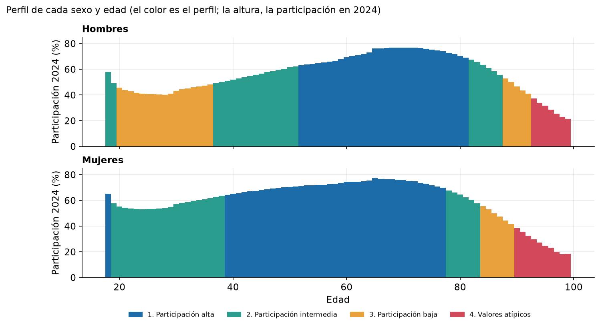
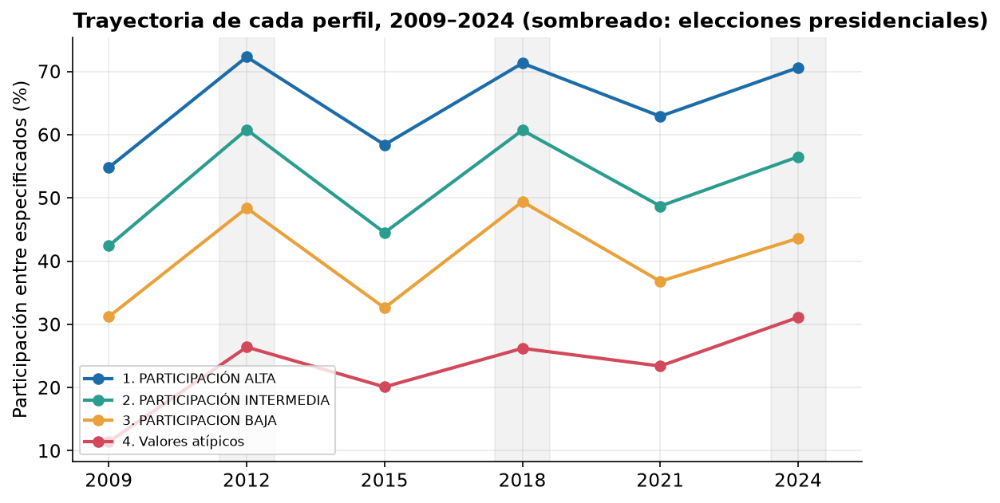
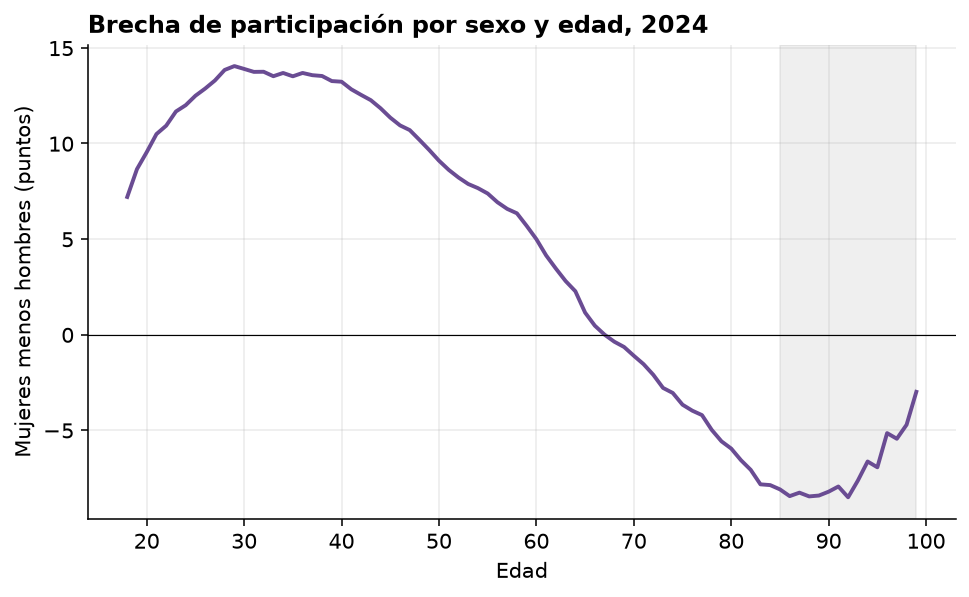
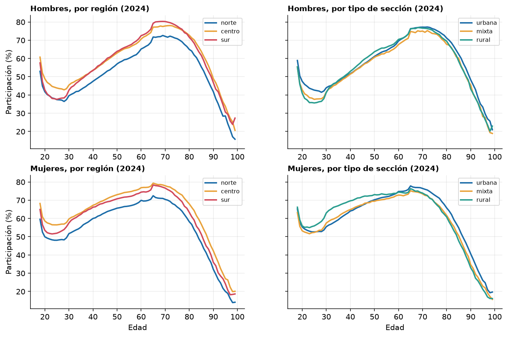
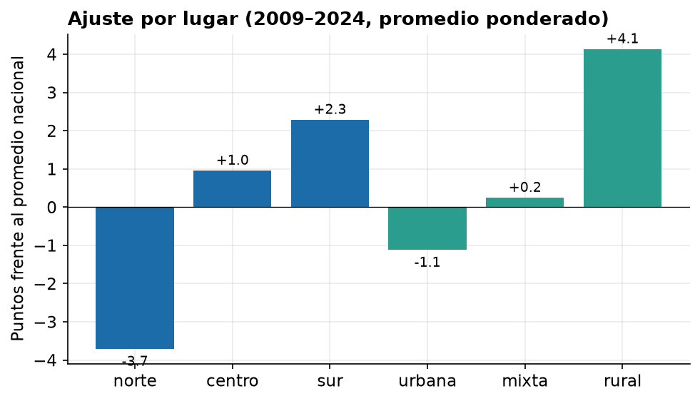
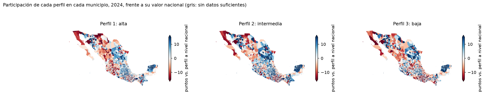
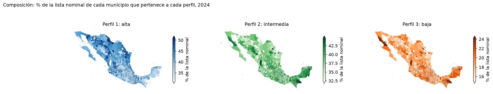
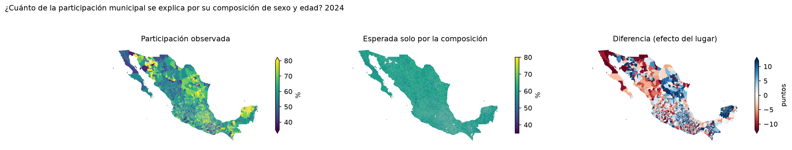
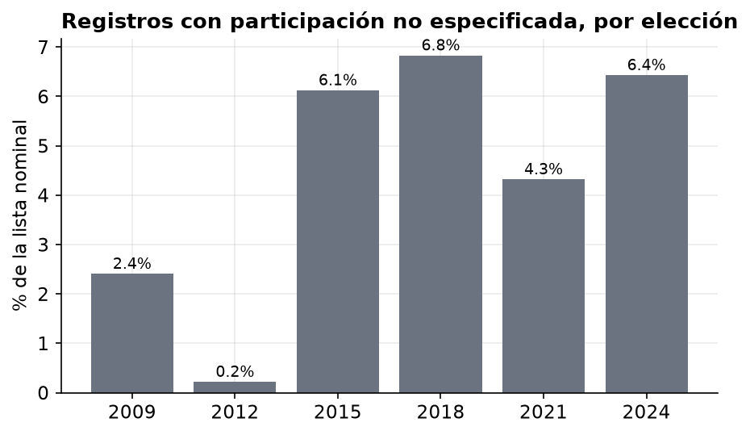

# Perfiles de participación por sexo y edad

Propuesta de cuatro perfiles nacionales de participación electoral, construidos con datos agregados del INE de las elecciones de 2009 a 2024, más un ajuste por lugar. Este documento explica qué son, por qué se llegó a esta estructura, cómo se trataron los datos y qué no se puede afirmar.

**Los perfiles describen participación observada en grupos de personas (sexo y edad), no a individuos ni las causas de su comportamiento.**

---

## 1. Resumen

- Los grupos que se comportan de forma parecida se definen por **sexo y edad**, y se repiten en todo el país. Cuatro perfiles resumen ese patrón.
- La **región** y el **tipo de sección** (urbana, mixta o rural) mueven sobre todo el *nivel* de participación en el norte, el centro, la zona urbana y la mixta, y por eso se tratan como un ajuste y no como perfiles distintos. **El sur y las secciones rurales son la excepción:** además del nivel cambia el patrón por edad.
- El **ciclo electoral** pesa mucho: en promedio, todos los perfiles suben entre 10 y 14 puntos en las elecciones presidenciales (2012, 2018 y 2024) frente a las intermedias (2009, 2015 y 2021).
- Dentro de una misma región hay mucha variación entre **municipios**, que se estudia aparte.

## 2. Los cuatro perfiles

| # | Perfil | Hombres | Mujeres | % de lista nominal (2024) | Participación 2024 |
|---|---|---|---|---|---|
| 1 | **Participación alta** | 52–81 años | 39–77 años (y 18) | 41.0% | 70.6% |
| 2 | **Participación intermedia** | 18–19, 37–51, 82–87 | 19–38, 78–83 | 39.0% | 56.5% |
| 3 | **Participación baja** | 20–36, 88–92 | 84–89 | 19.6% | 43.6% |
| 4 | **Muy mayores (90+)** | 93–99 | 90–99 | 0.4% | 31.1% |

Participación entre registros con situación especificada (votos entre votos más no votos), por elección:

| Perfil | 2009 | 2012 | 2015 | 2018 | 2021 | 2024 |
|---|---|---|---|---|---|---|
| 1. Alta | 54.8 | 72.3 | 58.4 | 71.3 | 62.9 | 70.6 |
| 2. Intermedia | 42.4 | 60.8 | 44.5 | 60.7 | 48.7 | 56.5 |
| 3. Baja | 31.2 | 48.4 | 32.6 | 49.4 | 36.8 | 43.6 |
| 4. Muy mayores | 11.4 | 26.4 | 20.1 | 26.2 | 23.4 | 31.1 |

**Cómo leer la figura 1.** La participación cambia de forma continua con la edad; los perfiles son cortes de esa curva, no grupos con fronteras naturales. Los límites exactos (por ejemplo, 37 frente a 52 años) dependen del método y del número de perfiles elegido, y no son umbrales reales.

### Descripción de cada perfil

1. **Participación alta.** Es el núcleo adulto: mujeres de 39 a 77 años y hombres de 52 a 81. Participa entre 55% y 63% en elecciones intermedias y entre 70% y 72% en presidenciales. Las mujeres llegan a este nivel unos 13 años antes que los hombres.
2. **Participación intermedia.** Reúne a quienes están en transición: mujeres jóvenes (19–38), hombres de mediana edad (37–51) y personas de 78–87 años cuya participación va cayendo. Su participación sube unos 14 puntos, en promedio, de las elecciones intermedias a las presidenciales.
3. **Participación baja.** Reúne a dos grupos que no se parecen entre sí pero tienen niveles y ciclo similares: los **hombres jóvenes de 20 a 36 años** y las personas de **84 a 92 años**. Compartir perfil no significa tener las mismas razones ni necesitar la misma intervención.
4. **Muy mayores (90+).** Participación de 11% a 31%. Es muy pequeño (0.4% de la lista nominal), por lo que debe tratarse con cautela (véase la sección 6).

## 3. Por qué esta estructura

### 3.1 Por qué sexo y edad juntos

La edad es el factor principal, y el sexo cambia a qué edad empieza y termina cada nivel. En 2024, las mujeres participan más que los hombres hasta los 66 años, con una diferencia máxima de 14 puntos a los 29 años; desde los 67 la relación se invierte, y a los 85 son unos 8 puntos menos.

Por eso los límites de edad de un perfil difieren por sexo: las mujeres alcanzan el nivel alto a los 39 años y los hombres a los 52; salen de él a los 77 y 81. Agrupar solo por edad ocultaría esta diferencia y mezclaría, por ejemplo, a mujeres de 25 años con hombres de 25 años, cuya participación es muy distinta.

### 3.2 Por qué cuatro perfiles

Se comparó el agrupamiento de 164 segmentos (sexo × edad simple, de 18 a 99 años) para 2 a 6 grupos, con k-means y con el método de Ward, usando la silhouette y la estabilidad frente a submuestras del 80% (ARI):

| Grupos | Silhouette (k-means) | ARI medio | ARI mínimo |
|---|---|---|---|
| 2 | **0.605** | 0.897 | 0.636 |
| 3 | 0.593 | **0.966** | 0.852 |
| 4 | 0.566 | 0.959 | 0.817 |
| 5 | 0.518 | 0.889 | 0.759 |
| 6 | 0.505 | 0.916 | 0.781 |

- Con 2 grupos la silhouette es mejor, pero es el agrupamiento menos estable.
- Con 3 y 4 grupos el resultado es muy estable y se separan estructuras que con 2 quedan mezcladas: los muy mayores y la diferencia por sexo.
- **Se eligió 4 por criterio, no porque los datos prueben que existan exactamente cuatro tipos.** Si se prefiere simplicidad, con 3 grupos el perfil 4 se fusiona con el 3. Es un resumen útil de un patrón continuo.

### 3.3 Por qué los perfiles son nacionales y no por región o por tipo de sección

Se compararon las curvas de sexo × edad × elección por región y por tipo de sección con la curva nacional:

- La curva nacional explica el 95% de la variación en las celdas de cada región y de cada tipo de sección. Si a cada grupo se le suma un nivel propio, el ajuste sube a 99.6% (regiones) y 98.9% (tipos).
- Al agrupar de nuevo dentro de cada región y tipo, y comparar con los perfiles nacionales, el acuerdo es alto (ARI de 0.94 a 0.99 en centro y norte, 0.93 en urbana y mixta) y **el orden de los perfiles se repite en todos los cortes**: el 1 siempre participa más que el 2, el 2 más que el 3 y el 3 más que el 4.

Las diferencias frente a la curva nacional se pueden separar en dos partes: el **nivel** (cuánto más o menos participa el grupo en promedio) y lo que **queda después de quitarlo**, que recoge diferencias en el patrón por edad y de una elección a otra:

| Lugar | Nivel frente al nacional (puntos) | Lo que queda tras quitar el nivel (puntos) |
|---|---|---|
| Norte | −3.7 | 1.5 |
| Centro | +1.0 | 1.1 |
| Sur | +2.3 | 2.7 |
| Urbana | −1.1 | 1.2 |
| Mixta | +0.3 | 1.4 |
| Rural | +4.1 | 3.6 |
| Sur rural | +6.7 | 4.8 |

**Excepción: el sur y las secciones rurales, sobre todo el sur rural.** Ahí lo que queda después de quitar el nivel es tan grande como el nivel o más, y los perfiles propios coinciden menos con los nacionales (ARI de 0.73 en rural y 0.64 en sur rural). Se recomienda tratarlas como un caso aparte.

**Matiz.** Que 95% de la variación se explique con edad y sexo no vuelve irrelevante el lugar: la edad domina tanto que 4 a 7 puntos de diferencia por región o tipo siguen siendo relevantes en la práctica.

### 3.4 El lugar importa más a nivel de municipio que de región

En un análisis por municipio (≈1,600 municipios con datos suficientes en 2024), la diferencia de participación entre adultos de 35–64 y jóvenes de 18–34 va de **7.9 a 21.6 puntos** entre municipios (percentiles 10 a 90), y la de 35–64 frente a 85+ de 14.0 a 33.3. La entidad explica 41% y 28% de esa variación; el resto ocurre dentro de la entidad. Por eso la región es un descriptor grueso, y el detalle territorial se presenta como una capa aparte (mapas y análisis espacial en el [README principal](../../README.md)).

### 3.5 Los perfiles por municipio (capa territorial)

`scripts/21_mapas_perfiles.py` lleva los cuatro perfiles al nivel de municipio en 2024, con dos medidas distintas: la **composición** (qué proporción de la lista nominal del municipio pertenece a cada perfil) y la **participación de cada perfil en el municipio**, frente a su valor nacional.

**Qué muestran** (2,463 municipios con datos suficientes):

1. **Los municipios se parecen mucho en quién vive en ellos.** La proporción de lista nominal en el perfil 3 tiene una mediana de 19.3% (nacional: 19.6%), con un rango de 16.7% a 22.0% entre el percentil 10 y el 90.
2. **Esa composición casi no explica su participación.** Si cada perfil participara en un municipio como lo hace a nivel nacional, la participación esperada por composición variaría solo 0.9 puntos entre municipios (desviación estándar), frente a 11.5 puntos de la participación observada. La relación entre ambas es prácticamente nula (R² = 0.000). Las diferencias entre municipios se deben a **cuánto participa cada perfil allí**, no a la mezcla de sexo y edad.
3. **El efecto del lugar es en buena medida común a los tres perfiles.** Los municipios donde un perfil participa más que su valor nacional suelen ser los mismos para los otros: la correlación entre perfiles va de 0.73 a 0.92. La entidad explica entre 38% y 48% de esa variación. Esto respalda tratar el lugar como un ajuste de nivel.
4. **La forma también varía.** La diferencia entre el perfil 1 y el perfil 3 dentro de un municipio va de 16 a 40 puntos (percentiles 10 a 90), frente a 27 a nivel nacional.
5. **Lectura a ojo de los mapas:** la participación de los tres perfiles es mayor que la nacional en la península de Yucatán y menor en Baja California y parte de Sonora, lo que coincide con los ajustes de nivel por región.

**Avisos:**
- **Las geometrías son un dato externo al INE:** vienen del Marco Geoestadístico 2020 de INEGI, por una copia local en `data/external/` (ignorada por Git), y solo se usan para dibujar. Los 2,477 municipios de 2024 no se unen todos (los creados después de 2020 no tienen polígono).
- **Datos insuficientes.** Los mapas de participación exigen al menos 100 registros especificados por municipio y perfil. El perfil 4 solo cumple en 736 municipios y por eso no se muestra.
- **La escala de los mapas de composición está recortada** a los percentiles 2 y 98, lo que hace parecer grandes diferencias que en realidad son de pocos puntos.
- **Los municipios grandes en superficie dominan visualmente** aunque tengan pocas personas, y los pequeños tienen más ruido.
- **Son asociaciones, no causas.** Y el padrón puede contener registros de personas que ya no residen en el municipio.
- La media de la diferencia entre participación observada y esperada (+2.9 puntos) es de los municipios sin ponderar; los municipios pequeños participan más que los grandes.

## 4. Cómo se trataron los datos

### Años anteriores a 2024
Los perfiles se construyen con **las seis elecciones** (2009, 2012, 2015, 2018, 2021 y 2024): cada segmento se describe por su participación en cada una. Las columnas de 2024 son solo el corte más reciente. El resultado no depende de un año: sin 2009 los perfiles coinciden en 94% (ARI 0.94) y usando solo las presidenciales en 91% (ARI 0.91).

### Registros con participación no especificada (NS)
La participación se calcula como `SV / (SV + NV)`: los no especificados **no se cuentan como voto ni como abstención**. Pesan distinto según la elección:

- No se concentran en ninguna edad ni sexo: por tramo de edad la diferencia máxima dentro de un año es de unos 0.7 puntos, y entre hombres y mujeres de 0.1.
- **Prueba de sensibilidad:** al contarlos como "no votó" (`SV / LN`), los 164 segmentos conservan su perfil (ARI = 1.0).
- Lo que no se puede saber es cuántos de ellos votaron realmente: las elecciones con más no especificados tienen una participación más incierta, aunque esa incertidumbre afecta a todos los grupos por igual.

### Personas no binarias
Se excluyen de los perfiles y de los demás análisis. El INE solo registra esta categoría en 2024, con 105 registros (0.0001% de la lista nominal); sin historial en las seis elecciones no se puede construir una trayectoria. Su participación en 2024 es de 77.5%, pero con una muestra tan pequeña no es interpretable. **Es una limitación de los datos, no una decisión sobre su relevancia.** Se describen aparte en `reports/sociodemografico/no_binario_descriptivo.csv`.

### Edades de 100 años o más
Se excluyen (≈0.02% de la lista nominal): el original llega a registros de hasta 140 años, probablemente errores. El dataset maestro las incluye en el grupo 85+.

### Correspondencia entre el dataset maestro y los originales
Se verificó que el dataset maestro coincide **celda por celda** con los conteos originales (546,968 celdas, sin diferencias en lista nominal, votos, no votos, no especificados ni registros de origen). Los análisis de este documento parten de los conteos originales con edad simple.

## 5. Cómo cambia frente a los perfiles anteriores

Los perfiles publicados antes ([fichas por región](../sociodemografico/fichas_dos_perfiles_por_region.md)) usaron grupos de edad y tipo de sección, y encontraron dos perfiles por región: menor participación (jóvenes y 85+) y mayor participación (adultos).

| Aspecto | Antes | Ahora |
|---|---|---|
| Número de perfiles | 2 por región | 4 nacionales |
| Jóvenes | Todos en el perfil de menor participación | Los hombres jóvenes en el perfil bajo, las mujeres jóvenes en el intermedio |
| 85+ | Mezclados con los jóvenes | Separados de los jóvenes y en dos perfiles (84–92 y 90+) |
| Sexo | Variable descriptiva | Parte de la definición del perfil |
| Región y tipo de sección | Parte de la definición | Ajuste de nivel |

La comparación no invalida lo anterior: con grupos de edad más gruesos y la región como parte del segmento, el resultado natural eran dos perfiles; con edad simple y sexo aparece la estructura más fina.

## 6. Límites

- **No hay causas.** Son datos agregados de grupos, no de personas, y no incluyen motivos, escolaridad ni ingreso. Cualquier explicación de por qué participa menos un perfil es una hipótesis.
- **Edad, periodo y cohorte no se pueden separar.** Los perfiles describen cortes de un mismo momento y no siguen a las mismas personas; que los jóvenes participen menos puede deberse a la edad, a la generación o a la época, y con estos datos no se distingue.
- **Los límites entre perfiles no son umbrales naturales.** Dependen del método y de k.
- **Los muy mayores pueden estar mal medidos.** La lista nominal podría incluir personas fallecidas o que ya no residen en su sección, lo que haría parecer menor la participación real de ese grupo. **No se verificó con los datos disponibles**, así que es una posibilidad y no un hallazgo. El perfil 4 es especialmente sensible a esto.
- **La regionalización norte/centro/sur es una propuesta del proyecto**, no una división oficial.
- **El análisis es nacional.** Las diferencias locales (municipio, sección rural del sur) pueden ser grandes.
- **No hay validación externa.** No se contrastó contra encuestas ni contra otra fuente de participación.

## 7. Hipótesis de acción (a probar con pilotos)

Son hipótesis para diseñar pruebas, no recomendaciones basadas en causas:

| Perfil | Hipótesis |
|---|---|
| 1. Alta | Sostener el acceso a información cívica y a la casilla; evaluar qué funciona localmente antes de trasladarlo a otros grupos. |
| 2. Intermedia | Reforzar la continuidad en elecciones intermedias, cuando su participación baja unos 14 puntos frente a las presidenciales. |
| 3. Baja | Diseñar acciones **separadas** para hombres jóvenes (20–36) y para personas de 84–92 años; sus razones probablemente son distintas. |
| 4. Muy mayores | Antes de actuar, verificar la calidad del padrón; después, explorar barreras de movilidad y de acceso. |
| Secciones rurales del sur | Tratar como un caso aparte, con acciones adaptadas al lugar. |

## 8. Cómo reproducirlo

Con los datos originales de `data/raw/` procesados por `scripts/01_etl_calidad.py` y `scripts/02_cubo.py`:

| Script | Qué hace |
|---|---|
| `17_perfiles_edad_sexo.py` | Agrupa sexo × edad simple y compara de 2 a 6 perfiles |
| `18_perfiles_por_region_tipo.py` | Compara los perfiles por región y tipo de sección |
| `19_revision_ns_nobinario.py` | Revisión de no especificados, no binarios y sensibilidad |
| `20_figuras_perfiles.py` | Genera las figuras y tablas de esta carpeta |
| `21_mapas_perfiles.py` | Mapas municipales de composición y participación por perfil (fig7 a fig9) |

Las dependencias están en `requirements-analysis.txt`. Semilla fija: 42.

## 9. Archivos de esta carpeta

- `composicion_perfiles.csv`: edades de cada perfil por sexo.
- `trayectorias_perfiles.csv`: participación por perfil y elección y tamaño en la lista nominal.
- `asignacion_segmentos_sexo_edad.csv`: perfil de cada combinación de sexo y edad.
- `perfiles_edad_sexo_comparacion.csv`: comparación de 2 a 6 grupos.
- `perfiles_region_tipo_comparacion.csv`: comparación por región y tipo de sección.
- `fig1`–`fig9`: figuras de este documento.
- `municipios_perfiles_2024.csv`: composición, participación por perfil y diferencia con lo esperado por municipio, 2024.

## 10. Referencias

- Estudio de tipologías de participación política con análisis de clases latentes en cuatro países europeos, con tipos estables entre países y proporciones distintas: [orbilu.uni.lu](https://orbilu.uni.lu/handle/10993/61294).
- Comparación de métodos de agrupamiento para datos mixtos: [arXiv 2511.19755](https://arxiv.org/pdf/2511.19755).
- Sobre la dificultad de separar edad, periodo y cohorte: [Generations and political engagement (preprint)](https://tuhat.helsinki.fi/ws/files/159573531/Generations_and_political_engagement_preprint_.pdf).
- Zens, *Bayesian Adaptive Tensor Smoothing for Multiway Demographic Counts*: [arXiv 2502.09255](https://arxiv.org/abs/2502.09255). Se usó solo como inspiración de un análisis exploratorio, no como método de estos perfiles.

*Resumen de las fuentes: las referencias provienen de una búsqueda bibliográfica no sistemática; conviene verificarlas en el original antes de citarlas.*
